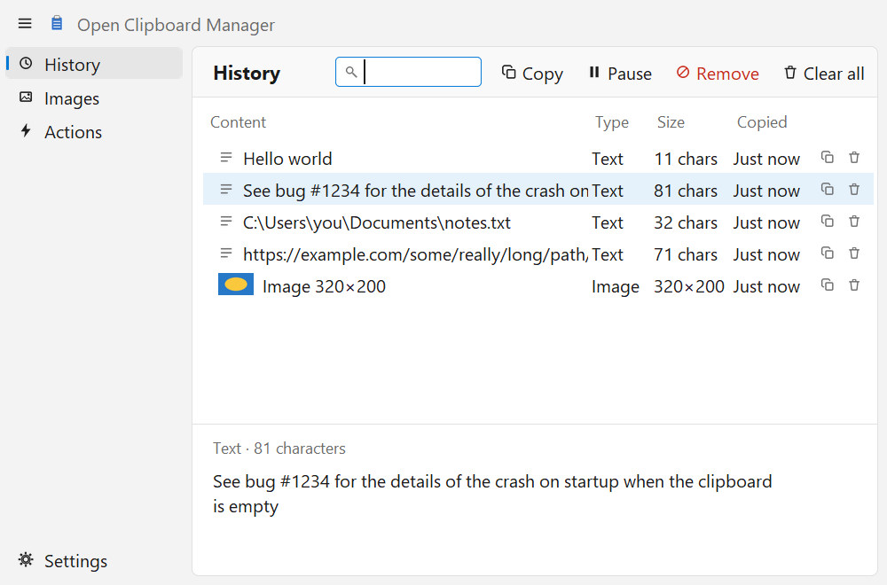
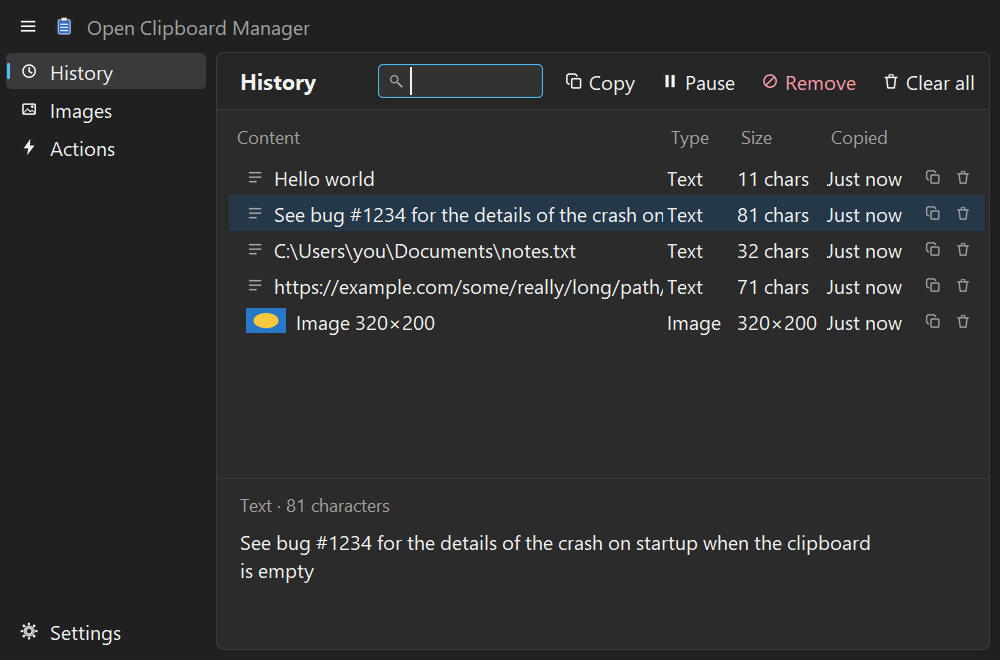
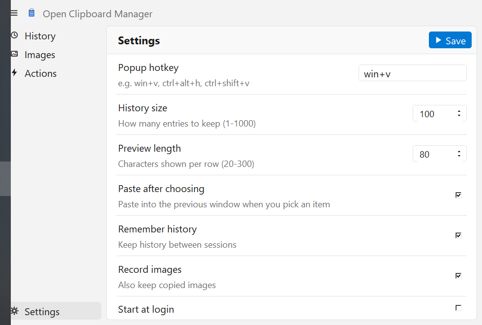

<p align="center">
  
</p>

<h1 align="center">Open Clipboard Manager</h1>

<p align="center">
  A small, open-source clipboard history manager: text and images, a global hotkey, regex-matched
  actions, and a window styled after <strong>Open Task Manager</strong> (the Windows&nbsp;11 Task Manager
  layout). Built with Python and Tk for Windows, Linux and macOS, modelled on Xfce's Clipman.
</p>

<p align="center">
  <a href="https://github.com/sabaoongfx/open-clipboard-manager/releases">
    
  </a>
</p>

<p align="center">
  <a href="#install">Install</a> ·
  <a href="#features">Features</a> ·
  <a href="#development">Development</a> ·
  <a href="#releasing">Releasing</a>
</p>

---

<p align="center">
  
  <br />
  
  <br />
  
</p>

## What it is

Open Clipboard Manager remembers what you copy. Press **Win+V**, pick an earlier entry, and it is pasted
into the window you were in. Win+V is the default on every system: on Windows it replaces Windows' own
clipboard panel while the app runs, on Linux it is Super+V, and on macOS it is **Ctrl+Cmd+V**, because
Cmd+V is the system Paste shortcut. You can change it in Settings. Everything stays on your computer:
no telemetry, no account, no network access.

It follows the look of [Open Task Manager](#credits): a navigation rail on the left, a card with a
title and toolbar, a flat table, rounded controls, and light/dark colours that follow your system.

## Install

### Windows

Download [`Open-Clipboard-Manager-x64.exe`](https://github.com/sabaoongfx/open-clipboard-manager/releases/latest/download/Open-Clipboard-Manager-x64.exe)
(always the newest version) and run it. It is a single portable file; the first launch takes a few
seconds while it unpacks. It isn't code-signed yet, so SmartScreen may warn you: choose
*More info → Run anyway*. A checksum file (`SHA256SUMS.txt`) is attached to every release.

The app lives in the system tray; use *Settings → Start at login* to launch it with Windows.

### Linux

Download [`Open-Clipboard-Manager-x86_64`](https://github.com/sabaoongfx/open-clipboard-manager/releases/latest/download/Open-Clipboard-Manager-x86_64),
make it executable and run it:

```bash
chmod +x Open-Clipboard-Manager-x86_64
./Open-Clipboard-Manager-x86_64
```

It needs a few helper programs from your package manager:

| What for                  | X11                | Wayland                            |
| ------------------------- | ------------------ | ---------------------------------- |
| Reading/writing clipboard | `xclip`            | `wl-clipboard`                     |
| Pasting into the old window | `xdotool`        | `wtype` (or `ydotool`)             |
| Global hotkey (Super+V)   | built in (X11 only)| not possible: see below            |

On **Wayland** no application can grab a global key, so bind a desktop shortcut (for example Super+V in
your desktop's keyboard settings) to `Open-Clipboard-Manager-x86_64 --show`. It opens the window of the
running copy. On GNOME the tray icon also needs the AppIndicator extension. Wayland support needs a
compositor that allows `wl-clipboard` to read the clipboard in the background (wlroots-based ones do;
GNOME may flicker).

### macOS

Download [`Open-Clipboard-Manager-macos-arm64.zip`](https://github.com/sabaoongfx/open-clipboard-manager/releases/latest/download/Open-Clipboard-Manager-macos-arm64.zip)
(Apple Silicon), unzip it and drag the app to Applications. It isn't signed or notarized, so the first
time, right-click the app and choose *Open*. Auto-paste needs the Accessibility permission under
*System Settings → Privacy & Security*.

The macOS build is started and checked by CI on a real Mac, and the tests run there, but nobody has used
the clipboard, hotkey and paste on a Mac yet, so expect rough edges and please report them.

### From source (any of the three)

```bash
git clone https://github.com/sabaoongfx/open-clipboard-manager
cd open-clipboard-manager
pip install -r requirements.txt
python winclipman.py          # on Windows, `pythonw` hides the console
```

Needs Python 3 with Tk (the python.org installers include it). Developed and tested on Python 3.14.
Running the app again (or `python winclipman.py --show`) opens the window of the copy that is already
running instead of starting a second one.
## Features

### History

- **Text and images**: screenshots and copied pictures are kept as thumbnails; text shows its length.
- **Search as you type**: the box is focused when the window opens. Type `image` to find pictures.
- **Pick and paste**: Enter or double-click copies the entry back and pastes it into the window you
  came from (when opened with the hotkey). Opened from the tray, it only copies.
- **Remove, clear, pause**: toolbar buttons; `Delete` removes the selected entry.
- **Preview pane**: the full text, or a larger picture, of the selected entry.
- **Images tab**: the same list, pictures only.

### Actions

Regex-matched commands, in the spirit of Clipman's actions. Right-click an entry to see the ones that
match: open a URL, look up a bug number, show a file in Explorer or Finder. Edit them from the *Actions*
tab (*Edit actions*, then *Reload*); your copy lives in the data folder as `actions.json`.

Clipboard text is stripped of quotes, backslashes, line breaks (and, on macOS, `$` and backticks)
before it is placed in a command, but an action is still a shell command: only add ones you trust.

### Settings

Popup hotkey (changes take effect immediately), history size (1-1000), preview length, paste after
choosing, remember history between sessions, record images, and start at login.

### Look

Sidebar with a collapse button, rounded card/buttons/inputs, accent colours, and light or dark mode
that follows the operating system each time the window opens.

## Roadmap

- Using the macOS and Linux backends on real machines, and fixing what that turns up.
- Intel macOS and ARM Linux builds.
- Signed Windows builds and a notarized macOS app.
- Rounded table rows and scrollbar (the standard Tk table can't draw them).
- Sharper rendering on high-DPI screens.
- A window for editing actions without a text editor.

## Tech stack

| Layer            | Choice                                                    |
| ---------------- | --------------------------------------------------------- |
| Language / UI    | Python 3 + Tk (`tkinter`, `ttk`), drawn icons via Pillow  |
| Tray icon        | [pystray](https://github.com/moses-palmer/pystray)        |
| Windows backend  | Win32 clipboard, keyboard hook / `RegisterHotKey`, registry (`ctypes`)|
| Linux backend    | `xclip` / `wl-clipboard`, `xdotool`, python-xlib hotkey    |
| macOS backend    | NSPasteboard via PyObjC, Carbon `RegisterEventHotKey`     |
| Packaging        | PyInstaller (single-file Windows exe)                     |
| Testing          | `unittest` (no extra dependencies)                        |

## Development

### Prerequisites

Python 3 with Tk (developed and tested on 3.14). On macOS also `pip install pyobjc-framework-Cocoa` (included in
`requirements.txt`).

### Run it

```bash
pip install -r requirements.txt
python winclipman.py
```

### Run the tests

```bash
python -m unittest discover -s tests -v
```

They use a temporary folder, so your real history and settings are never touched, and need no
clipboard. The window tests need a display and skip themselves where Tk can't start. The macOS
backend is tested against stand-in modules (PyObjC only exists on a Mac), so those tests cover
parsing and the interface, not the real pasteboard or hotkey.

### Build the Windows executable

```bash
pip install pyinstaller
pyinstaller --noconfirm --clean --onefile --windowed --name Open-Clipboard-Manager-x64 ^
  --icon assets/icon.ico --add-data "actions_windows.json;." --add-data "actions_macos.json;." ^
  --hidden-import pystray._win32 winclipman.py
```

The result is `dist/Open-Clipboard-Manager-x64.exe`.

### Regenerate the icons

```bash
python tools/make_assets.py     # writes assets/icon.png, assets/icon.ico, public/*.svg
```

## Releasing

1. Bump `APP_VERSION` in `platform_base.py` and add an entry to `CHANGELOG.md`.
2. Push a `v*` tag. `.github/workflows/release.yml` runs the tests on Windows, Linux and macOS, builds
   the Windows exe, the Linux binary and the macOS app, starts each one and checks that a second launch
   hands over to the first (`tools/smoke_test.py`), then attaches them, plus `SHA256SUMS.txt`, to a
   **draft** GitHub release. Files are uploaded under versionless names (`Open-Clipboard-Manager-x64.exe`,
   `Open-Clipboard-Manager-x86_64`, `Open-Clipboard-Manager-macos-arm64.zip`), so the
   `releases/latest/download/…` links in this README always give the newest version.
3. Publish the draft.

`.github/workflows/ci.yml` runs the same tests on every push.

## Project structure

```
winclipman.py         The app: history, actions, settings logic, events, tray, startup, command line
ui.py                 The window: theme, rounded widgets, pages (History, Images, Actions, Settings)
instance.py           Single-instance link: a second launch / --show reaches the running copy
platform_base.py      App name/version and the interface every OS backend implements
platform_windows.py   Win32 clipboard, Win+V keyboard hook, paste, registry autostart
platform_linux.py     xclip / wl-clipboard, X11 hotkey, xdotool / wtype paste, autostart entry
platform_macos.py     NSPasteboard, Carbon hotkey, paste, LaunchAgent autostart
actions_*.json        Default actions per OS
assets/, public/      Icon files and the logo (generated by tools/make_assets.py)
tools/                make_assets.py (icons), smoke_test.py (used by the release workflow)
docs/                 README screenshots
tests/                unittest suite
.github/workflows/    ci.yml (tests on 3 OSes), release.yml (tests + 3 builds + draft release)
```

## How it talks to the OS

The Tk thread polls the clipboard every 300 ms and only reads the contents when it changes: through the
change counter on Windows (`GetClipboardSequenceNumber`) and macOS (`NSPasteboard.changeCount`), and by
hashing what `xclip` / `wl-paste` return on Linux, which has no such counter. The global hotkey runs on
its own thread on Windows (a message loop; Win+V goes through a low-level keyboard hook that swallows the
keys, because Windows owns that combination, and taps an unassigned key so the Start menu stays closed),
on its own X11 connection on Linux, and through the app's event loop on macOS. Other threads (tray menu,
hotkey, the image encoder, the single-instance listener) never touch the UI: they post an `Event` to a
queue that the Tk thread drains every 100 ms.

The running app listens on a loopback port, recorded in the data folder, so that starting it again opens
the existing window instead of a second copy.

Images are hashed and saved as PNG files in the data folder on a worker thread, then added to the
history on the Tk thread. History is stored as JSON next to them: `%APPDATA%\winclipman` on Windows,
`~/Library/Application Support/winclipman` on macOS, `~/.local/share/winclipman` on Linux.
## Credits

The window design follows [Open Task Manager](https://github.com/sabaoongfx/Open-Task-Manager)'s
colours and layout. The idea and the actions feature come from Xfce's
[Clipman](https://gitlab.xfce.org/panel-plugins/xfce4-clipman-plugin); this is an independent
rewrite and contains none of its code.

## License

[MIT](LICENSE)
